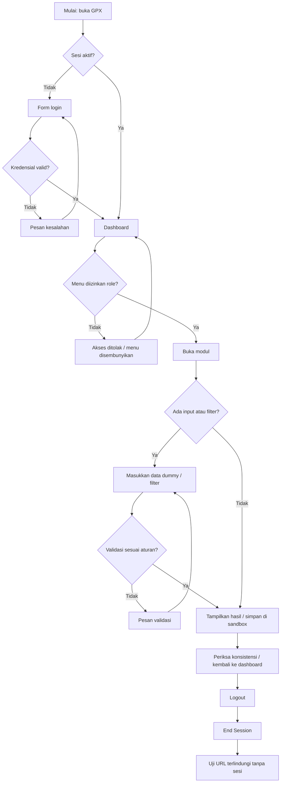

# 02. Analisis Alur dan Rencana White Box GPX

## Kedudukan analisis
Diagram ini adalah **model alur pengguna** yang perlu dikonfirmasi saat pengujian. Ini bukan bukti bahwa kode sumber telah diaudit atau seluruh branch telah tercakup. Teknik white-box pada Pertemuan 3 memerlukan akses kode, fungsi yang diuji, dan bukti statement/branch/path coverage.

## Rencana pemeriksaan kode (hanya bila akses tersedia)
| Area kode | Cabang yang dianalisis | Bukti yang diperlukan |
|---|---|---|
| Handler login | Valid / invalid / field kosong | Source function, test unit, hasil assertion |
| Middleware sesi | Sesi aktif / kedaluwarsa / logout | Tes request dan branch coverage |
| Permission/role | Diizinkan / ditolak | Matrix role dan assertion |
| Validasi form | Data valid / kosong / batas nilai | Unit test dan kasus batas |
| Transaksi data | Sukses / gagal / rollback | Mock/sandbox, log teredaksi |

Tanpa akses kode, hanya **black-box functional flow** yang dapat dinilai. Jangan membuat persentase coverage sebelum instrumentasi dan eksekusi nyata.