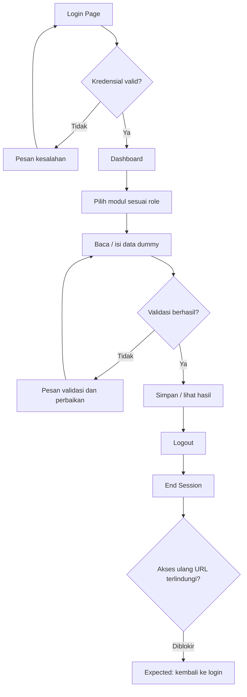

# 02. White-Box / Flow Analysis — GPX

**Status:** PERENCANAAN, bukan hasil code review.

## Alur konseptual E2E

## Area analisis kode bila diberikan izin
- Middleware autentikasi dan session expiration.
- Role-based authorization pada route dan API.
- Error handling input dan server.
- Integritas operasi tulis dan audit log.
- Pengujian unit/branch untuk logika khusus modul.

**Batasan:** tanpa audit source code, analisis ini merupakan *flow analysis*, bukan bukti cakupan white-box.
