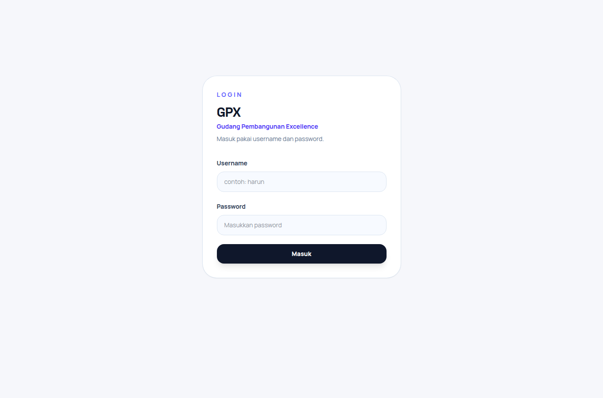

# Bukti visual pengujian GPX

## Screenshot halaman publik
Screenshot berikut diambil melalui browser otomatis **dari halaman asli GPX**, tanpa login dan tanpa mengirim kredensial. Proses pengambilan ada di [capture-gpx-public.mjs](../../.github/scripts/capture-gpx-public.mjs) dan [workflow](../../.github/workflows/capture-gpx-public.yml).

| ID | Halaman | Desktop | Mobile | Batasan |
|---|---|---|---|---|
| VIS-001 | Login publik | [Screenshot](GPX-LOGIN-public-desktop.png) | [Screenshot](GPX-LOGIN-public-mobile.png) | Bukti UI publik, bukan bukti login berhasil |

**Perhatian:** tautan gambar baru akan aktif setelah workflow pengambilan screenshot berhasil dan mengunggah kedua file PNG. Jika tidak muncul, lihat status di tab Actions.

## Bukti pengujian internal
Gambar dashboard sesudah login, modul Training, Consumables, laporan dan Logout hanya dapat dijadikan bukti setelah pengujian sah dengan akun uji. Jangan mengunggah screenshot memuat NIK, identitas karyawan, transaksi asli, token, atau informasi bisnis sensitif. Bukti internal belum tersedia dan status test case terkait tetap NOT RUN.
