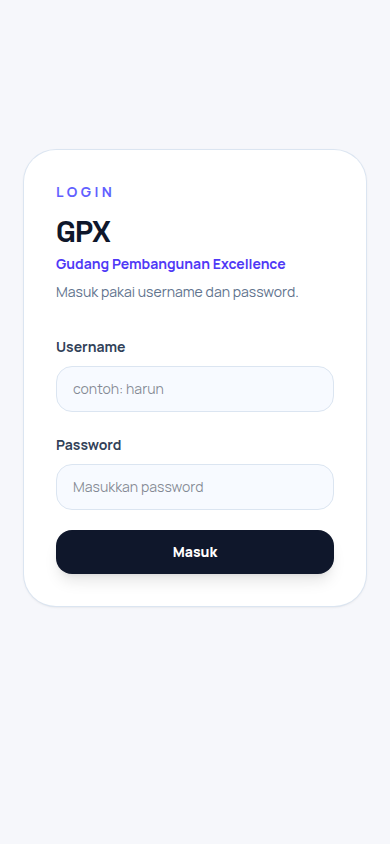

# Bukti visual pengujian GPX

## Screenshot halaman publik
Dua gambar berikut merupakan tangkapan layar halaman Login asli GPX. Gambar diperoleh melalui browser headless tanpa mengirimkan kredensial. Keduanya telah tersimpan di repository. Skrip pengambilan manual tersedia di [capture-gpx-public.mjs](../../.github/scripts/capture-gpx-public.mjs).

| ID | Halaman | Desktop | Mobile | Batasan |
|---|---|---|---|---|
| VIS-001 | Login publik | [Screenshot](GPX-LOGIN-public-desktop.png) | [Screenshot](GPX-LOGIN-public-mobile.png) | Bukti UI publik, bukan bukti login berhasil |

Pengambilan gambar baru dan publikasi berikutnya dilakukan secara manual oleh anggota tim melalui akun GitHub masing-masing. Tidak ada workflow yang membuat commit otomatis.

## Bukti pengujian internal
Gambar dashboard sesudah login, modul Training, Consumables, laporan, dan Logout hanya dapat dijadikan bukti setelah pengujian sah menggunakan akun uji. Jangan unggah screenshot yang memuat NIK, identitas karyawan, transaksi asli, token, atau informasi sensitif. Bukti internal belum tersedia dan status test case terkait tetap NOT RUN.
