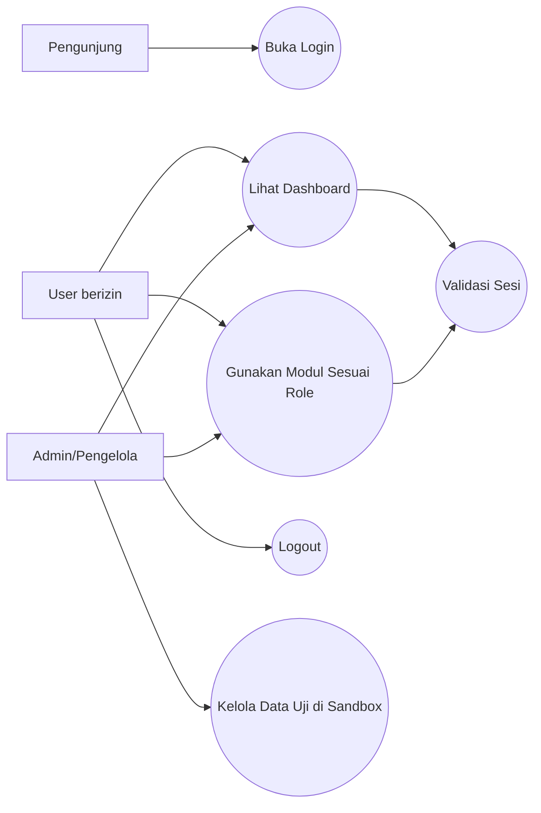

# Matriks Role dan Use Case (Rancangan GPX)

## Aktor
- **Pengguna terautentikasi:** memakai fitur sesuai pemberian akses.
- **Admin/pengelola:** mengelola fitur tertentu bila role tersebut tersedia dan diizinkan dalam scope.
- **Pengunjung tanpa sesi:** hanya dapat mengakses halaman publik seperti Login.

Hak akses pasti setiap role belum dikonfirmasi; tabel di bawah merupakan **pertanyaan verifikasi**, bukan daftar izin aktual.

| Use case | Pengunjung | User berizin | Admin/pengelola | Cara validasi |
|---|---|---|---|---|
| Lihat Login | Diharapkan ya | Ya | Ya | Buka /login |
| Dashboard | Diharapkan tidak | Sesuai role | Sesuai role | Navigasi/URL langsung |
| Training/Assessment | Tidak | Sesuai role | Sesuai role | Buka menu setelah login |
| Lihat laporan/filter | Tidak | Sesuai role | Sesuai role | Filter dummy |
| Edit data | Tidak | Tergantung role | Tergantung role | Sandbox saja |
| Logout | N/A | Ya | Ya | Klik Logout |
| Dashboard setelah logout | Tidak | Tidak | Tidak | Akses URL lama |

## Diagram use case

**Verifikasi:** cantumkan screenshot role/menu hanya setelah pengujian aktual dan penyamaran identitas.