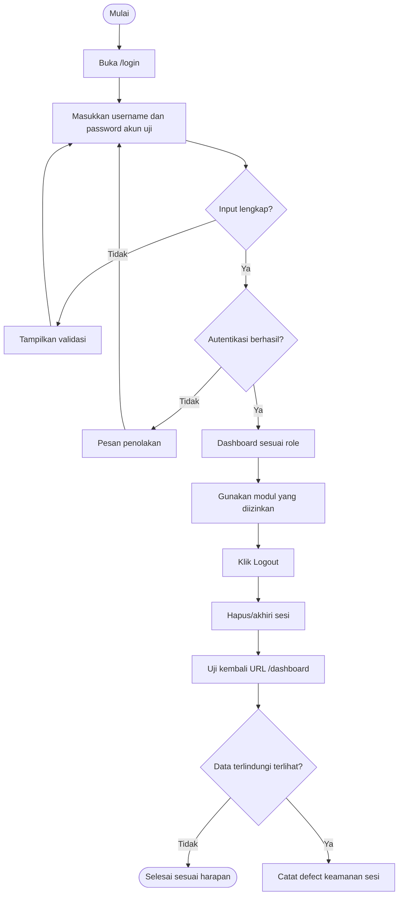

# System Flowchart: Login dan Logout GPX

Diagram berikut bersifat logis; diambil dari perilaku aplikasi yang diharapkan, bukan reverse engineering source code GPX.

## Alternatif yang wajib diuji
- Input kosong.
- Password salah.
- Akses URL dashboard tanpa sesi.
- Tombol kembali setelah logout.
- Login ulang setelah logout.

Lihat `Test Scenario` dan `Test Case` untuk expected result detail.