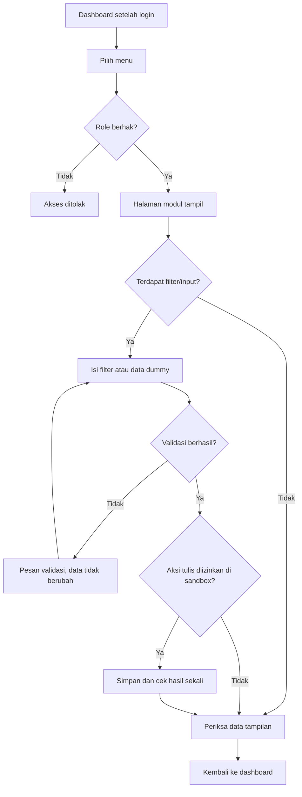

# System Flowchart: Navigasi dan Validasi Modul GPX

Diagram berlaku sebagai model umum untuk fitur dalam scope. Jika menu tidak punya form edit, pengujian tulis ditandai N/A.

Periksa: empty state, tabel, total agregat, konsistensi filter, kesalahan respons, dan perilaku refresh.